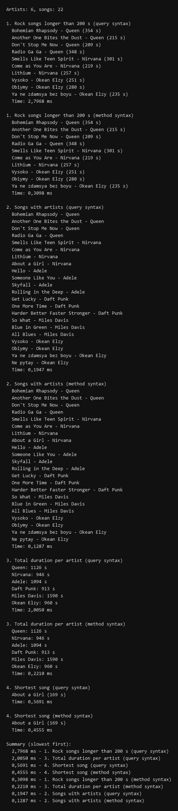

# Лабораторна робота №10

**Тема:** LINQ в дії: фільтри, join, агрегації. Продуктивність.

**Варіант:** 9 — Музична бібліотека

Проєкт: `lab10v9`.

## Класи сутностей

### Artist

- Властивості: `Id` (int), `Name` (string), `Genre` (string)
- Конструктор: `Artist(int id, string name, string genre)`

### Song

- Властивості: `Id` (int), `Title` (string), `ArtistId` (int), `DurationSeconds` (int)
- Конструктор: `Song(int id, string title, int artistId, int durationSeconds)`

## Тестові дані

6 виконавців (Rock, Pop, Electronic, Jazz) і 22 пісні. Дані створюються прямо в `Program.cs`.

## Запити

Кожен запит написаний у двох синтаксисах (запитів і методів). Час вимірюється через `Stopwatch`, результат виводиться разом з часом.

1. Усі пісні жанру "Rock" тривалістю понад 200 секунд — `Join` + `Where`
2. Пісні разом з виконавцями (назва пісні та ім'я виконавця) — `Join`
3. Загальна тривалість пісень для кожного виконавця — `GroupJoin` + `Sum`
4. Найкоротша пісня — `orderby ... First()` і `MinBy`

## Висновок про продуктивність

На 22 піснях усі запити виконуються за мілісекунди або менше, тому різниця між ними невелика. Найдовше зазвичай виконується перший запит, бо при першому запуску .NET ще компілює код (JIT), а наступні запити вже швидші. Якщо запит у синтаксисі запитів показав довший час за такий самий запит у синтаксисі методів, це здебільшого через те, що він виконується першим у парі. Сам синтаксис на швидкість не впливає, бо компілятор перетворює запити на виклики методів. Запити з `Join` і `GroupJoin` дорожчі за простий пошук мінімуму, бо вони порівнюють ключі двох колекцій. На великих колекціях різниця між операціями була б помітнішою.

## Запуск

```
cd OOP-Kasianchyk
dotnet run --project lab10v9
```

## Приклад виводу


