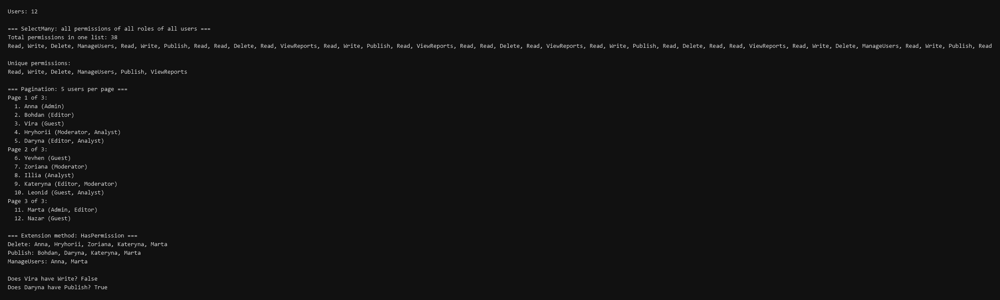

# Лабораторна робота №11

**Тема:** LINQ: SelectMany, пагінація й custom extensions.

**Варіант:** 9 — Користувачі та їхні ролі з дозволами

Проєкт: `lab11v9`.

## Класи сутностей

### Permission

- Властивості: `Id` (int), `Name` (string)

### Role

- Властивості: `Id` (int), `Name` (string), `Permissions` (List&lt;Permission&gt;)

### User

- Властивості: `Id` (int), `Name` (string), `Roles` (List&lt;Role&gt;)

### UserExtensions

- Метод розширення `HasPermission(this User user, string permissionName)` — перевіряє, чи є в користувача дозвіл з такою назвою в будь-якій із його ролей

## Тестові дані

12 користувачів, 5 ролей (Guest, Editor, Moderator, Analyst, Admin) і 6 дозволів. Деякі користувачі мають по дві ролі.

## Запити

1. **SelectMany:** `users.SelectMany(u => u.Roles).SelectMany(r => r.Permissions)` — усі дозволи всіх ролей усіх користувачів в одному списку
2. **Пагінація:** користувачі по 5 на сторінку через `Skip` і `Take`, виводяться всі 3 сторінки поспіль
3. **Custom Extension:** `HasPermission` — використовується для пошуку користувачів з певним дозволом

## Запуск

```
cd OOP-Kasianchyk
dotnet run --project lab11v9
```

## Приклад виводу


