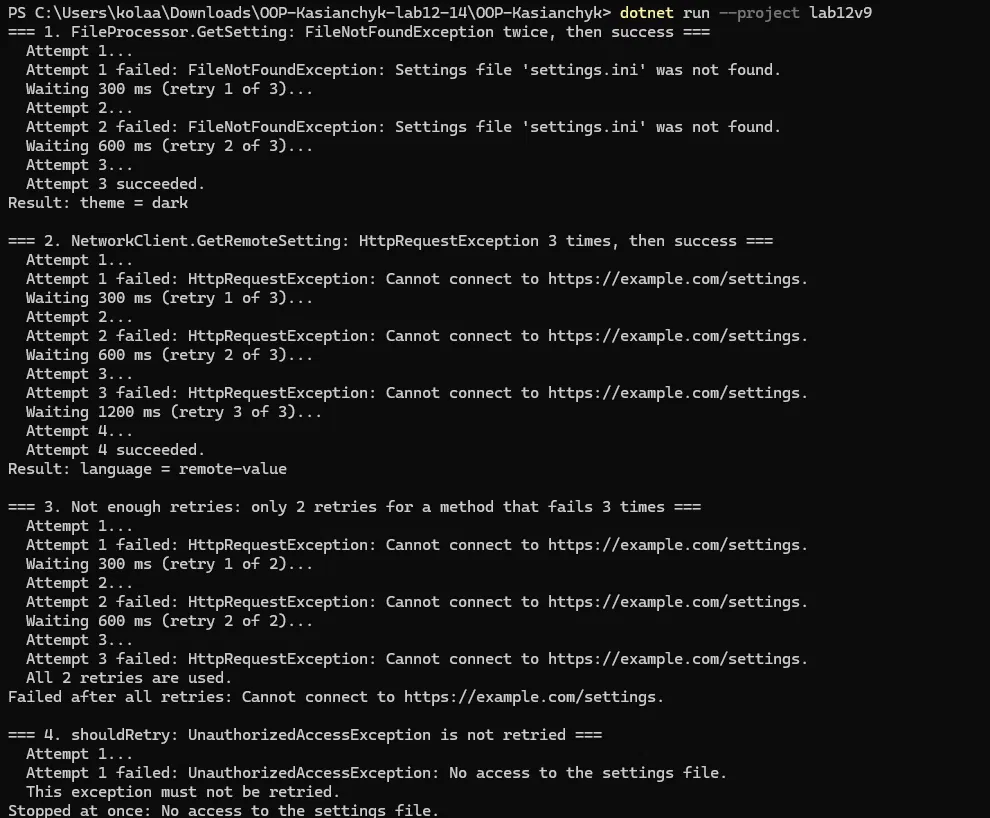

# Лабораторна робота №12

**Тема:** Обробка IO/мережевих помилок та патерн Retry.

**Варіант:** 9 — Читання налаштувань

Проєкт: `lab12v9`.

## Класи

### FileProcessor

- Метод `string GetSetting(string path, string key)` — читає налаштування з файлу (імітація)
- Перші 2 виклики кидають `FileNotFoundException`, далі виклик успішний
- Метод `Reset()` скидає лічильник спроб

### NetworkClient

- Метод `string GetRemoteSetting(string url, string key)` — отримує налаштування з сервера (імітація)
- Перші 3 виклики кидають `HttpRequestException`, далі виклик успішний
- Метод `Reset()` скидає лічильник спроб

### RetryHelper

Статичний клас з узагальненим методом:

```csharp
public static T ExecuteWithRetry<T>(Func<T> operation, int retryCount = 3,
    TimeSpan initialDelay = default, Func<Exception, bool>? shouldRetry = null)
```

- `operation` — операція, яку треба виконати
- `retryCount` — максимальна кількість повторних спроб
- `initialDelay` — початкова затримка (якщо не задана, береться 500 мс)
- `shouldRetry` — визначає, чи повторювати спробу для цього винятку; у варіанті 9 повторюються `FileNotFoundException` і `HttpRequestException`
- затримка перед повтором: `initialDelay * 2^retryAttempt`
- кожна спроба, її результат і затримка виводяться в консоль
- після останньої невдачі, а також для винятку, який не треба повторювати, кидається той самий виняток

## Що показує Main

Початкова затримка 300 мс, `shouldRetry` повторює лише `FileNotFoundException` і `HttpRequestException`.

1. `FileProcessor.GetSetting`: дві невдачі, на третій спробі успіх
2. `NetworkClient.GetRemoteSetting`: три невдачі, на четвертій спробі успіх
3. Мало повторів: `retryCount: 2` для методу, який збоїть 3 рази, тому після всіх спроб кидається виняток
4. `shouldRetry`: `UnauthorizedAccessException` не повторюється, виняток кидається одразу

## Висновок про експоненційну затримку

Після кожної невдачі затримка подвоюється: `initialDelay * 2^retryAttempt`. У цьому варіанті при початковій затримці 300 мс перед повторами програма чекає 300 мс, 600 мс, 1200 мс. Для `FileProcessor` (дві невдачі) загальне очікування 900 мс, а для `NetworkClient` (три невдачі) 2100 мс, тобто сервіс отримує все більше часу на відновлення, і ми не засипаємо його запитами.

## Запуск

```
cd OOP-Kasianchyk
dotnet run --project lab12v9
```

## Приклад виводу




