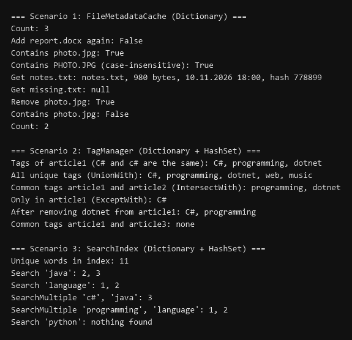

# Самостійна робота №14

**Тема:** Вивчення Dictionary&lt;TKey, TValue&gt; та HashSet&lt;T&gt; у бібліотеках .NET.

Проєкт: `IndependentWork14`. Звіт з аналізом open-source прикладів і порівняльною таблицею — у файлі [REPORT.md](REPORT.md).

## Класи

### FileMetadata

- Властивості: `FileName` (string), `Size` (long), `LastModified` (DateTime), `Hash` (string)

### FileMetadataCache (сценарій 1, Dictionary)

- Поле: `Dictionary<string, FileMetadata> _cache` (ключі без урахування регістру)
- Методи: `Add`, `Get`, `Remove`, `Contains`
- Властивість: `Count`

### TagManager (сценарій 2, HashSet)

- Поле: `Dictionary<string, HashSet<string>> _articleTags` (ArticleId → теги)
- Методи: `AddTag`, `RemoveTag`, `GetTags`
- `GetAllUniqueTags` — всі унікальні теги (`UnionWith`)
- `FindCommonTags` — спільні теги двох статей (`IntersectWith`)
- `FindUniqueTags` — теги, які є лише в першій статті (`ExceptWith`)

### SearchIndex (сценарій 3, додатково, Dictionary + HashSet)

- Поле: `Dictionary<string, HashSet<int>> _invertedIndex` (слово → документи)
- Методи: `AddDocument`, `Search`, `SearchMultiple` (документи, де є всі слова)

## Що показує Main

Усі три сценарії по черзі. Для всіх рядків і тегів використовується `StringComparer.OrdinalIgnoreCase`, тому "C#" і "c#" вважаються однаковими.

## Запуск

```
cd Самостійні/Самостійна_14
dotnet run --project IndependentWork14
```

## Приклад виводу


