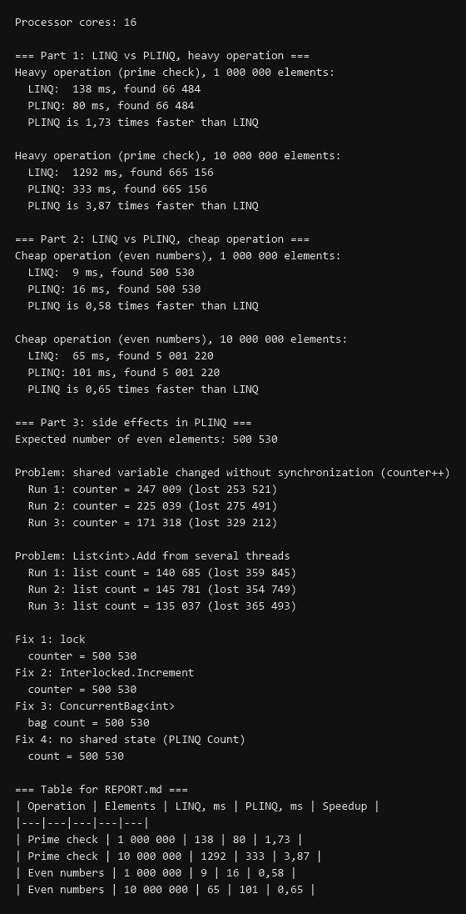

# Самостійна робота №18

**Тема:** PLINQ: дослідження продуктивності та безпеки.

Проєкт: `IndependentWork18`. Опис експериментів і висновки — у файлі [REPORT.md](REPORT.md).

## Що робить програма

1. Створює `List<int>` з випадковими числами (`Random` з seed 42).
2. **Важка операція** (перевірка числа на просте): порівнює `LINQ` і `PLINQ` (`AsParallel()`) для 1 000 000 і 10 000 000 елементів.
3. **Проста операція** (парні числа): те саме порівняння для тих самих розмірів.
4. **Побічні ефекти:** показує, що змінна `counter++` і `List.Add` у PLINQ без синхронізації дають неправильний результат.
5. **Виправлення:** `lock`, `Interlocked.Increment`, `ConcurrentBag<int>` і PLINQ без спільного стану (`Count`).

Час вимірюється через `Stopwatch`, результати виводяться в консоль. В кінці програма друкує готову Markdown-таблицю з результатами, її треба вставити у `REPORT.md`.

## Запуск

Запускати треба в режимі Release, щоб вимірювання були чесними. Перший розділ може працювати кілька секунд.

```
cd Самостійні/Самостійна_18
dotnet run --project IndependentWork18 -c Release
```

## Приклад виводу


